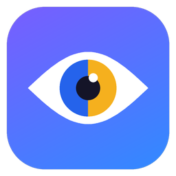

# AKENO COLORVISION

**Make colors easier to distinguish.** Akeno ColorVision is a Windows 11 accessibility app for people
who have trouble telling many shades of red, green, brown and gray apart. It applies a color transform to
the **whole screen** — desktop, browsers, videos, Discord and games such as Minecraft — that turns colors
which normally look the same into different colors or different brightness.

> **What it is not:** software cannot repair or replace cone cells, so this app cannot "cure" color
> blindness or let anyone see colors exactly the way people with typical color vision do. Its goal is
> narrower and practical: help you tell apart things that currently look identical. Corrected colors can
> look unnatural — that is expected.

<p align="center"></p>

## Features

| | |
|---|---|
| **System-wide filter** | One click (or `Ctrl + Alt + Shift + F`) turns the correction on or off for the entire screen, using the Windows Magnification API. |
| **Correction methods** | Red-Green Assistance, Protan Assistance, Deutan Assistance, Strong Separation, Brightness & Contrast, Minecraft — Nether Visibility, and fully custom profiles. |
| **Personal calibration** | A 5-minute guided wizard: describe your experience, rate color pairs, pick the version that works best, check a game-style scene (or your own Minecraft screenshot). Not a medical test. |
| **Minecraft mode** | A preset tuned for dark reds, browns and grays, switched on automatically while Minecraft (Java or Bedrock) is in front. No mods, no injection. |
| **Color identifier** | Point at anything and press `Ctrl + Alt + Shift + C` to see the color's name in words ("Dark Red — Category: Red — #8B2424"). |
| **Safety first** | Emergency reset shortcut (`Ctrl + Alt + Shift + Backspace`), a "Reset colors" button, a stand-alone reset tool, a crash watchdog and safe mode. |
| **Private** | Works offline. No account, no telemetry, no screen recording. Everything stays on your PC. |

## Download and install

1. Download **`Akeno-ColorVision-v0.1.0-win-x64.zip`** from the
   [Releases page](https://github.com/YTDxDAkeno/AKENO-COLORVISION/releases) (or the latest build artifact
   under [Actions](https://github.com/YTDxDAkeno/AKENO-COLORVISION/actions)).
2. Right-click the ZIP → **Extract All…** → choose a folder (for example `Documents\Akeno ColorVision`).
3. Double-click **`AkenoColorVision.exe`**. No .NET, Visual Studio or anything else needs to be installed.
   Keep both `.exe` files in the same folder.
4. Windows may show *"Windows protected your PC"* because the app is new and not code-signed.
   Click **More info → Run anyway**. (Optionally compare the ZIP with its `.sha256` file first.)

An optional per-user installer (`Akeno-ColorVision-Setup-v0.1.0.exe`, no administrator rights) is built
too; it adds Start-menu shortcuts including *Emergency Reset* and *Safe mode*.

**Requirements:** Windows 11, 64-bit (Windows 10 1809 or later should also work but is untested).

## First launch

1. The app opens on **Home**. Click **Turn filter on** — your screen colors change immediately.
2. Move the **Correction strength** slider until differences are clear but comfortable.
3. Go to **Calibration** and follow the steps to create *your* profile (recommended).
4. Open **About → Check that the filter works on this PC** once; it swaps red and blue for 5 seconds so
   you can confirm the filter really changes your screen.

## Turning the filter on and off

* The big button on **Home**, the button in the left sidebar, or the **tray icon** menu.
* Shortcut anywhere, even in games: **`Ctrl + Alt + Shift + F`** (changeable in **Settings**).
* **Hold to compare** (Color Filters page) shows the original colors while held.
* Closing the window keeps the app (and filter) running in the tray; use **Exit** in the tray menu to quit.

## Calibration

Five short steps, about five minutes. There are no wrong answers.

1. Pick the description that fits you best (for example *"Many red and green shades look gray or brown"*).
2. Rate color pairs: *Clearly different*, *Slightly different*, *Almost the same*, *Exactly the same*.
3. Choose the corrected version that makes pairs easiest to tell apart, then the strength, then fine-tune.
   *Try on whole screen* previews an option for 10 seconds.
4. Check a Nether-style test scene (original artwork, no game textures) or load your own screenshot.
5. Name and save your profile.

Tips: turn off Windows *Night light* and preferably HDR during calibration — they change colors.
The app never tells you what type of color vision deficiency you have; it only finds settings that help.

## Minecraft

* **Gaming → Minecraft profile** chooses what is used while Minecraft is in front
  (default: *Minecraft — Nether Visibility*).
* **Automatic switching** (on by default) activates it when Minecraft: Java Edition (`javaw.exe` with a
  "Minecraft…" window) or Minecraft for Windows (Bedrock) is in front, and restores your previous profile
  shortly after you switch away or close the game. Optionally it also turns the filter on while you play.
* Detection reads only the program name and window title — no game files, no memory access, no injection.
* If the colors do not change inside the game, use windowed or maximized-window mode instead of
  exclusive fullscreen (Java Edition: press **F11** to leave fullscreen).
* In-game behaviour has **not yet been verified** on real hardware for this version — see
  [docs/TESTING.md](docs/TESTING.md) for the checklist.

## Troubleshooting

| Problem | What to do |
|---|---|
| Screen colors look wrong / too extreme | `Ctrl + Alt + Shift + Backspace`, **Reset colors**, or run `AkenoColorVision-EmergencyReset.exe`. |
| App frozen and colors stuck | Run `AkenoColorVision-EmergencyReset.exe` — it asks the app to reset, closes it if it does not answer, and resets the colors itself. |
| Filter has no effect in a game | Use borderless/windowed mode; exclusive-fullscreen games can bypass desktop color effects. |
| Colors look washed out or odd with HDR | Try with HDR off (Settings → System → Display). The app shows a note when HDR / advanced color is on. |
| Windows color filters are also on | They stack with this app. Turn one off (Settings → Accessibility → Color filters). |
| A shortcut does not work | Another program uses it. Choose a new one in **Settings → Keyboard shortcuts** (the status says why). |
| App starts with the filter off and a "Safe mode" note | It did not close normally last time or the emergency reset was used. Click **Turn filter on**. Hold **Shift** while starting to force safe mode. |
| SmartScreen warning | Expected for unsigned apps: **More info → Run anyway**. |
| Need help | **Settings → Export diagnostics** creates a text file without screenshots or personal data. |

## Documentation

* [User guide](docs/USER-GUIDE.md) — for everyday use, no technical knowledge needed
* [Technical architecture](docs/TECHNICAL-ARCHITECTURE.md) — rendering backends, threads, safety design
* [Color science](docs/COLOR-SCIENCE.md) — algorithms, sources and simulation results
* [Compatibility](docs/COMPATIBILITY.md) — what is verified and what is not
* [Testing](docs/TESTING.md) — automated tests, results and manual checklists (incl. Minecraft)
* [Release process](docs/RELEASE.md) — how builds and releases are produced
* [Entwickler-Zusammenfassung (Deutsch)](docs/ENTWICKLER-ZUSAMMENFASSUNG.md)

## Building from source

```
dotnet build Akeno.ColorVision.sln -c Release
dotnet test tests/Akeno.ColorVision.UnitTests
pwsh scripts/package.ps1 -Version 0.1.0      # Windows: portable ZIP in dist/
./scripts/package.sh 0.1.0                   # Linux/macOS cross-build
```

Requires the .NET 10 SDK. The Windows-only projects compile on Linux/macOS thanks to
`EnableWindowsTargeting`; running the app requires Windows.

## Status of this version (0.1.0)

| Check | Status |
|---|---|
| Compiles for Windows x64 | ✅ (CI on `windows-latest`, and cross-compiled on Linux) |
| Unit tested | ✅ color math, profiles, settings, hotkeys, filter state machine, calibration, game detection, recovery |
| Integration tested on Windows | ✅ 18 tests on GitHub's Windows runner: Magnification API round-trip, real-backend lifecycle, hotkeys, screen sampling — and proof that the filter transforms the composed desktop image pixel-exactly ([TESTING.md](docs/TESTING.md#31-composed-output-observation)) |
| Visually verified on a Windows 11 monitor | ❌ not yet — please run the manual checklist |
| Tested inside Minecraft | ❌ not yet — please run the Minecraft checklist |
| Code-signed | ❌ no certificate (SmartScreen warning expected) |

## License

MIT — see [LICENSE](LICENSE). Not affiliated with Microsoft or Mojang. Minecraft is a trademark of
Mojang Synergies AB.
